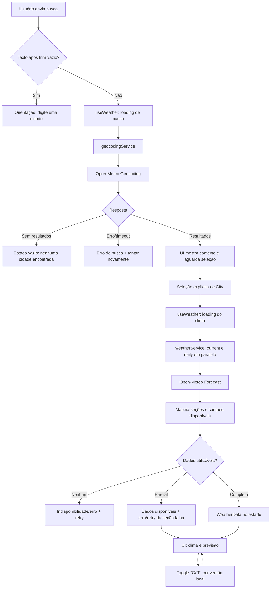

# Plano Técnico — Weather App

Este plano deriva decisões de implementação da fonte de verdade `specs/weather-app-spec.md`. Em caso de divergência, prevalecem os requisitos e critérios de aceite da spec. A entrega desta etapa é arquitetura e contratos; não inclui código de aplicação.

## Architecture (Overview)

Aplicação React de página única, dividida em apresentação, orquestração de estado, integração HTTP e funções puras. A UI não conhece URLs nem o formato bruto da Open-Meteo; os services validam e mapeiam respostas para os contratos internos.

```text
App
├── SearchForm / SearchResults
├── WeatherPanel / ForecastList / UnitToggle
└── Loading, Empty, Error e PartialError states
          │ props e callbacks
          ▼
       useWeather (estado e coordenação)
          │
          ├── geocodingService ── Open-Meteo Geocoding
          └── weatherService ──── Open-Meteo Forecast
                   │
                   ▼
       mapeadores e funções puras (lib)
       resposta externa → tipos internos → formatação/conversão
```

- **Apresentação:** componentes React acessíveis, responsáveis por exibir resultados, dados e estados.
- **Orquestração:** um hook no topo da tela coordena busca, seleção, consulta, retry e unidade; passa dados e ações por props.
- **Services:** concentram `fetch`, timeout, validação básica, tratamento de HTTP e mapeamento de respostas externas.
- **Funções puras:** convertem °C/°F, formatam valores e datas e traduzem códigos WMO em descrições pt-BR.
- **Rastreabilidade:** RF1 (busca/seleção), RF2–RF3 (dados atual e previsão), RF4 (unidade), RF5 (estados); RNF1–RNF7 orientam UI, resiliência, idioma, privacidade e suporte.

## Tech Stack

- **React 19 + TypeScript strict:** UI por componentes e contratos explícitos para respostas parciais.
- **Vite:** servidor de desenvolvimento e build já adotado pelo repositório.
- **Tailwind CSS:** estilos responsivos e tema do projeto; validar contraste WCAG 2.1 AA, não apenas aparência.
- **Fetch API nativa:** suficiente para chamadas HTTP simples sem adicionar cliente de rede.
- **Vitest + Testing Library:** testes unitários/de componentes; **Playwright** para fluxos E2E.
- **Biome e pnpm:** lint/formatação e gerenciador já configurados no projeto.
- **Open-Meteo:** geocoding e previsão, sem chave de API, conforme RF1–RF3 e assumptions da spec.

Usar as dependências e scripts existentes (`package.json`); não introduzir biblioteca de estado, roteador ou camada de cache para esta tela única.

## Project Structure

Estrutura proposta, alinhada à arquitetura do projeto e ao desafio do módulo:

```text
src/
├── components/
│   ├── states/             # loading, vazio, erro e erro parcial
│   ├── SearchForm.tsx      # busca explícita
│   ├── SearchResults.tsx   # lista de cidades com contexto geográfico
│   ├── WeatherPanel.tsx    # condições atuais e mensagens por seção
│   ├── ForecastList.tsx    # cinco dias
│   └── UnitToggle.tsx      # controles °C/°F
├── hooks/
│   └── useWeather.ts       # estado/orquestração da tela
├── services/
│   ├── geocodingService.ts # chamada e mapeamento de geocoding
│   └── weatherService.ts   # chamadas e mapeamento de forecast
├── lib/
│   ├── temperature.ts     # conversão e formatação
│   ├── weatherCode.ts     # código WMO → descrição/ícone interno
│   └── date.ts            # datas locais e apresentação pt-BR
├── types/
│   └── weather.ts         # contratos compartilhados
├── styles/                 # estilos globais/Tailwind
├── App.tsx                 # composição e props
└── main.tsx                # bootstrap React
```

Separar service de UI permite testar o mapeamento sem rede; manter funções de conversão e formatação puras simplifica validação de RF4. Evitar abstrações genéricas de serviços enquanto houver apenas estes dois recursos.

## Data Model

Contratos internos normalizados. Medidas numéricas ausentes ou inválidas são `null`; não preencher com zero, texto fictício ou valor estimado. Os valores de temperatura são armazenados em Celsius e convertidos somente para apresentação.

```ts
export type Unit = "celsius" | "fahrenheit";

export interface City {
  id?: number;
  name: string;
  country: string | null;
  countryCode?: string | null;
  region?: string | null; // admin1, quando fornecido
  latitude: number;
  longitude: number;
}

export interface CurrentWeather {
  temperatureC: number | null;
  condition: string | null; // descrição pt-BR derivada do weatherCode
  weatherCode: number | null;
  humidityPercent: number | null;
  windSpeedKmh: number | null;
  pressureHpa: number | null;
  precipitationMm: number | null;
  time: string | null; // hora local informada pela API
}

export interface ForecastDay {
  date: string; // YYYY-MM-DD no fuso retornado pela API
  minTemperatureC: number | null;
  maxTemperatureC: number | null;
  condition: string | null;
  weatherCode: number | null;
  precipitationMm: number | null;
}

export interface WeatherData {
  city: City;
  current: CurrentWeather | null;
  forecast: ForecastDay[] | null;
  timezone: string | null;
}
```

`current: null` ou `forecast: null` representa uma seção sem dados utilizáveis; `null` nos campos representa indisponibilidade pontual e deve ser exibido como “—”. Erros de transporte pertencem ao estado da consulta, não são valores meteorológicos. Se não houver nenhum dado utilizável, a tela comunica indisponibilidade e oferece retry (não confundir com busca geográfica válida sem resultados).

## Data Flow

1. A pessoa envia explicitamente o formulário. O app aplica `trim`; se vazio, não chama API e informa em pt-BR.
2. `useWeather` inicia busca e atualiza o estado de loading antes da resposta. O geocoding service codifica a consulta como parâmetro URL e normaliza os resultados.
3. Sem resultados: apresentar estado vazio. Com resultados: mostrar nome e contexto disponível e aguardar seleção manual.
4. Ao selecionar uma cidade, iniciar em paralelo as consultas de clima atual e previsão pelo service. O service aplica timeout e mapeia as respostas para Celsius e contratos internos.
5. O hook atualiza cada seção conforme seus resultados, preservando a cidade e os dados que chegaram com sucesso. A UI recebe estado e ações via props.
6. Alternar unidade atualiza apenas o estado local e deriva todas as temperaturas exibidas; não faz nova consulta. Uma previsão que chegue depois também é formatada na unidade já selecionada.
7. Uma falha de seção apresenta erro e retry daquela seção; ausência de todos os dados utilizáveis apresenta indisponibilidade geral com retry.



## External APIs

Todas as chamadas usam HTTPS e `URLSearchParams`/codificação equivalente para os parâmetros. Não incluir credenciais: Open-Meteo não exige chave para este escopo.

### Geocoding

```text
GET https://geocoding-api.open-meteo.com/v1/search
    ?name={cidade}&count=5&language=pt&format=json
```

- `name`: texto digitado, após `trim`.
- `count=5`: limita a lista apresentada a cinco resultados (RF1).
- `language=pt`: favorece nomes/localizações em português quando disponíveis.
- `format=json`: explicita JSON; é o formato padrão.
- Resposta típica resumida: `{ "results": [{ "id": 123, "name": "Lisboa", "latitude": 38.72, "longitude": -9.14, "country": "Portugal", "country_code": "PT", "admin1": "Lisboa" }] }`. `results` pode estar ausente quando não há correspondências.
- Mapeamento: `name`, `country`, `country_code`, `admin1`, coordenadas e `id` → `City`; região e país podem estar ausentes e não devem ser inventados. Falha HTTP/rede é erro; lista vazia é estado vazio.

### Forecast (clima atual e previsão diária)

Usar endpoint de previsão, com **duas consultas paralelas** à mesma cidade para permitir estados e retries independentes de clima atual e de previsão, conforme RF2, RF3 e RF5. Ambas usam:

```text
https://api.open-meteo.com/v1/forecast
  ?latitude={latitude}&longitude={longitude}&timezone=auto
```

Consulta atual:

```text
GET ...&current=temperature_2m,relative_humidity_2m,weather_code,wind_speed_10m,surface_pressure,precipitation
```

Consulta diária:

```text
GET ...&daily=weather_code,temperature_2m_max,temperature_2m_min,precipitation_sum&forecast_days=5
```

- `timezone=auto`: retorna dados e datas no fuso local da coordenada; usar o `timezone` retornado e tratar datas `YYYY-MM-DD` como datas civis, evitando deslocamento de dia por conversão UTC.
- `forecast_days=5`: hoje e os quatro dias seguintes (RF3).
- Omitir `temperature_unit` mantém Celsius padrão; explicitar `temperature_unit=celsius` para fixar o contrato interno em °C (RF4).
- Unidades de resposta consultáveis em `current_units`/`daily_units`; interpretar vento em km/h e precipitação em mm. A pressão `surface_pressure` é em hPa.
- Exemplo resumido da resposta atual: `{ "timezone": "Europe/Lisbon", "current_units": { "temperature_2m": "°C", "wind_speed_10m": "km/h" }, "current": { "time": "2026-11-05T15:00", "temperature_2m": 14.2, "relative_humidity_2m": 70, "weather_code": 3, "wind_speed_10m": 8.5, "surface_pressure": 1014.2, "precipitation": 0 } }`.
- Exemplo resumido da resposta diária: `{ "daily": { "time": ["2026-11-05", "2026-11-06", "..."], "weather_code": [3, 61, "..."], "temperature_2m_min": [10.1, 9.8, "..."], "temperature_2m_max": [16.4, 15.2, "..."], "precipitation_sum": [0, 2.1, "..."] } }`.
- Mapeamento: atuais `temperature_2m`, `relative_humidity_2m`, `weather_code`, `wind_speed_10m`, `surface_pressure`, `precipitation` → `CurrentWeather`; arrays de `daily` são associados por índice a cada `time` → `ForecastDay`. Descrições são derivadas do código WMO por mapeador local, não presumidas como texto da API. Array/campo ausente ou valor inválido vira `null`; manter os demais campos e dias válidos. Consultas sem campos previstos ou erro HTTP são erros da respectiva seção.

## State Management

Manter estado de tela em `useWeather` (sem store global): formulário/query, resultados geográficos, cidade selecionada, dados disponíveis, unidade e estado de busca/clima. A unidade começa em `celsius` a cada nova sessão e não é persistida (assumptions/RF4).

- Fases observáveis: `idle | loading | success | error | empty`, com operações de busca e clima identificadas separadamente.
- Clima atual e previsão têm estado independente (`idle | loading | success | error`), pois são requisições independentes. Isso permite exibir dados parciais e retry apenas da seção com falha.
- `WeatherData` contém os valores normalizados em Celsius. A UI deriva a exibição em Fahrenheit usando `F = C × 9/5 + 32`, e vice-versa por derivação a partir dos dados Celsius; não arredondar os valores armazenados. O toggle não dispara request e atualização posterior usa a unidade atual (RF4).
- Descer dados e callbacks por props; não duplicar o mesmo estado nos componentes. Manter resultados de busca até nova busca/seleção, conforme fluxo explícito.
- Não usar persistência local, servidor, cache de consulta, atualização automática nem modo offline, em conformidade com RNF6 e assumptions.

## Error Handling

- **Loading:** ativar imediatamente ao submeter busca/consulta e remover ao concluir, falhar ou expirar (RF5, RNF3–RNF4). Desabilitar apenas ações incompatíveis com a operação em andamento; não bloquear edição permanentemente.
- **Vazio:** campo em branco/whitespace não requisita e orienta; busca válida sem resultados informa que nenhuma cidade foi encontrada e permite editar. Não rotular como falha de serviço.
- **Erro de busca:** falha de rede, HTTP/provedor ou timeout comunica erro de geocoding e oferece retry da mesma busca.
- **Erro meteorológico:** preservar cidade. Exibir mensagem específica para atual ou previsão se aquela consulta falhar, sem ocultar a outra seção que carregou. Retry repete a consulta correspondente e volta a loading; se ambas falharem, comunicar indisponibilidade geral.
- **Resposta parcial:** cada medida ausente aparece como “—”; campos restantes continuam visíveis. Se uma seção inteira não fornecer dados utilizáveis, indicar indisponibilidade e oferecer retry. Não transformar ausência em zero.
- **Timeout:** usar `AbortController` com limite explícito de 8 segundos por chamada (decisão de implementação; ajustável após teste), converter abort/timeout em erro recuperável e sempre limpar loading. Não fazer retry automático nem tentativas infinitas; retry é ação do usuário (RNF4).
- **Concorrência:** ao iniciar nova busca ou selecionar outra cidade, abortar requisições anteriores quando possível e ignorar respostas obsoletas, evitando que resultado antigo sobrescreva a seleção atual.
- **A11y e idioma:** mensagens e rótulos em pt-BR; estados anunciados programaticamente (`role="status"`/`aria-live` para loading e resultado; `role="alert"` para erro), foco visível, botões nomeados e controles operáveis por teclado. Não depender apenas de cor ou ícone.
- **Responsividade e compatibilidade:** layout sem rolagem horizontal ou conteúdo essencial cortado a partir de 320 px; validar também desktop. Suportar as duas versões estáveis mais recentes de Chrome, Edge, Firefox e Safari na data de lançamento (RNF1, RNF7).
- **Privacidade:** sem login, dados enviados somente à Open-Meteo para atender a busca, sem telemetria, histórico ou persistência em servidor/local (RNF6). Não há funcionamento offline nem exibição de cache (assumptions).

## Testing Strategy

### Unitários e componentes (Vitest + Testing Library)

- Testar conversão C/F nos dois sentidos, unidade inicial Celsius, arredondamento/formatação e campo `null` → “—”; validar que alternar unidade não chama services novamente (RF4).
- Testar descrição de códigos WMO e formatação de datas pt-BR, incluindo fuso/datas civis.
- Mockar `fetch` nos services: URL/parâmetros codificados, resposta geocoding normal e vazia, HTTP inválido, timeout, JSON inválido, campos ausentes, arrays diários incompletos e mapeamento de unidades.
- Testar hook/componentes para submit vazio sem chamada, lista desambiguada selecionável, loading, estados vazio/erro diferentes, retry, falha parcial e resposta sem dados utilizáveis (RF1–RF5).
- Testar anúncio acessível, nomes dos controles, navegação por teclado e foco visível; verificar campos parciais não escondem dados válidos.

### E2E (Playwright)

- Fluxo de busca → selecionar cidade → clima e cinco dias; validar rótulos, contexto geográfico e unidade.
- Alternar °C/°F antes e depois da chegada da previsão, confirmando atualização de todos os valores sem nova chamada.
- Cobrir busca vazia, sem resultados, erro de geocoding, timeout, falha por seção, retry e conteúdo parcial usando rotas/interceptação controlada; testes não devem depender da disponibilidade da API externa.
- Viewports começando em 320 px e desktop: sem rolagem horizontal, conteúdo essencial visível.
- Exercitar teclado e semântica acessível nos fluxos principais.
- Executar nos navegadores Playwright disponíveis para cobrir Chrome, Firefox e WebKit/Safari; incluir Edge quando a infraestrutura permitir. Revisar a matriz para as duas versões estáveis mais recentes de cada navegador no release, conforme RNF7.

## Risks & Trade-offs

| Decisão / risco | Trade-off e mitigação |
| --- | --- |
| Duas chamadas ao mesmo endpoint Forecast | Permite falha parcial e retry específico de atual/previsão, mas aumenta chamadas e pode produzir momentos de observação ligeiramente diferentes. Manter ambas paralelas e informar os erros da seção correspondente. |
| Open-Meteo pode ficar lenta, indisponível ou limitar chamadas | Sem SLA e sem credencial nesta versão. Timeout, estado não bloqueante, mensagens em pt-BR e retry manual; E2E usa mocks, sem mascarar falha em testes unitários. |
| Geocoding pode retornar homônimos ou contexto incompleto | Mostrar apenas metadados fornecidos e exigir seleção manual; não inferir região/país ausentes (RF1). |
| Resposta meteorológica parcial ou mudança no formato | Acesso defensivo a campos, validação/mapeamento no service, `null` para indisponíveis e testes com fixtures; não descartar outras medidas/dias. |
| Conversão pode arredondar ou rotular incorretamente | Manter Celsius como fonte canônica e derivar apresentação; testar ambas as conversões e a unidade ao carregar dados (RF4). |
| Compatibilidade e acessibilidade em várias plataformas | Testar teclado, foco, anúncios, contraste WCAG 2.1 AA, viewport de 320 px e matriz de navegadores; ícones não substituem nomes acessíveis. |
| Sem cache, persistência ou offline | Reduz complexidade e respeita a spec, mas consultas dependem de conexão e uma nova sessão volta a °C; evolução dessas funções requer revisão explícita de escopo. |
| Duas rotas de teste (unit e E2E) | Vitest dá feedback rápido e determinístico; Playwright cobre integração visual/fluxos. Interceptar a rede no E2E evita flakiness e dependência do provedor, sem substituir testes de contrato do service. |
